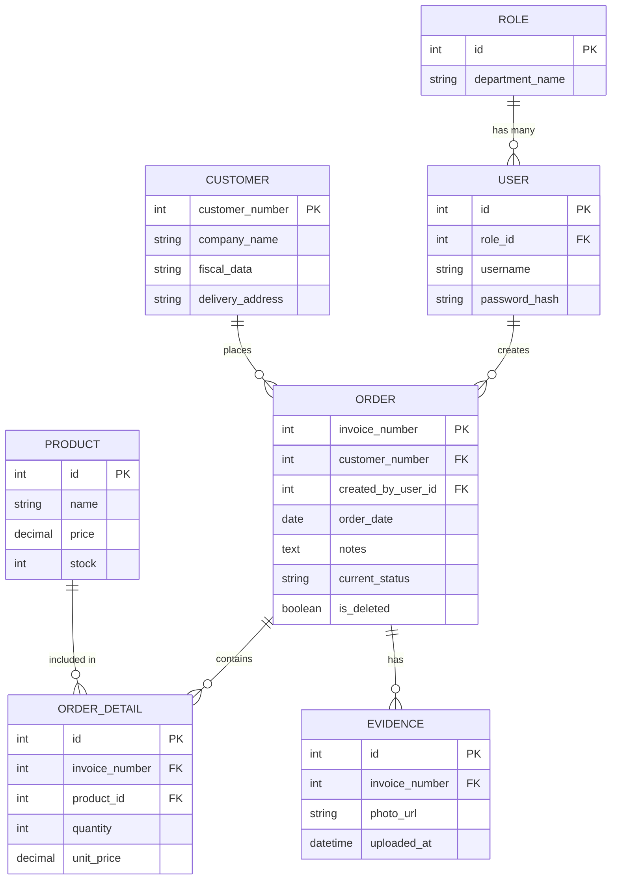

# Sistema Halcón - Evidencia CRM & Logística

## Descripción del Proyecto
Sistema de gestión de logística y seguimiento de entregas ("Sistema Halcón") diseñado para administrar clientes, roles de usuario, órdenes de compra, productos e inventario, adjuntando evidencia fotográfica y registro de estados de entrega.

## Diagrama Entidad-Relación (ERD)

---

## Evidence 2 - REST API Implementation

Backend update for **Sistema Halcón** implementing REST API endpoints for Users and Orders management.

### Available API Endpoints

#### Users (`/api/users`)
- **GET `/api/users`**: Retrieves a list of all users, including active and inactive users.
- **GET `/api/users/{id}`**: Retrieves information for a specific user.
- **POST `/api/users`**: Creates a new user.
- **PUT `/api/users/{id}`**: Updates basic information for a user.
- **PATCH `/api/users/{id}/deactivate`**: Changes a user's status to inactive.

#### Orders (`/api/orders`)
- **GET `/api/orders`**: Retrieves all orders, ordered from newest to oldest.
- **GET `/api/orders/{id}`**: Retrieves a specific order by ID.
- **GET `/api/orders/invoice/{invoice}`**: Searches for an order using its invoice number.
- **POST `/api/orders`**: Creates a new order.
- **PUT `/api/orders/{id}`**: Updates an existing order's information or status.
- **DELETE `/api/orders/{id}`**: Logically deletes (archives) an order.
- **GET `/api/orders/archived`**: Retrieves a list of all archived orders.